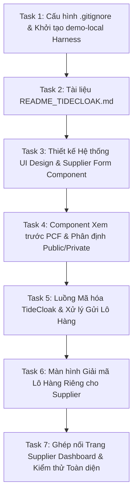

# Kế hoạch Triển Khai: Thành Viên 3 — `feat/supplier-ui` (Giao Diện Supplier & Tích Hợp TideCloak)

> **Dành cho Agentic Workers:** REQUIRED SUB-SKILL: Sử dụng `superpowers:subagent-driven-development` hoặc `superpowers:executing-plans` để thực hiện từng tác vụ trong kế hoạch này. Các bước sử dụng cú pháp checkbox (`- [ ]`) để theo dõi tiến độ.

**Mục tiêu:** Xây dựng hoàn chỉnh mô-đun giao diện nhà cung cấp (Supplier UI) thuộc phạm vi phân công của Thành viên 3 theo tài liệu đặc tả `docs/context.md`: biểu mẫu nhập lô hàng, điền dữ liệu mẫu, hiển thị lỗi theo đường dẫn trường (field path), xem trước kết quả PCF với phân định rõ ràng dữ liệu công bố và dữ liệu mã hóa mật, xác nhận gửi qua quy trình mã hóa TideCloak SDK (áp dụng 3 lưu ý kỹ thuật: `JSON.stringify`, tag `_tide_supplier_internal`, redirect URI), cơ chế giữ nguyên dữ liệu form khi gửi lỗi hoặc trùng mã lô 409, và màn hình giải mã kiểm chứng lô hàng riêng. Đồng thời tạo tài liệu hướng dẫn thiết lập bên thứ ba TideCloak và cô lập toàn bộ code hỗ trợ/mock của các thành viên khác vào thư mục `demo-local/` được khai báo trong `.gitignore`.

**Kiến trúc:**
- Tuân thủ nghiêm ngặt nguyên tắc độc lập và giao diện hợp đồng (contract-first) theo các Mục 7, 8, 9, 10, 11, 12, 13, 18, 22 trong `docs/context.md`.
- Code chính thức của Thành viên 3 nằm hoàn toàn trong `src/app/supplier/` và `src/components/Supplier/`.
- Tài liệu thiết lập dịch vụ bên thứ ba nằm tại `README_TIDECLOAK.md`.
- Toàn bộ code phục vụ chạy thử của các thành viên khác (Member 1: Auth/Crypto adapter, Backend API, Server Storage; Member 2: Logic PCF factors/calculate) được đưa hoàn toàn vào `demo-local/` và khai báo trong `.gitignore` để triệt tiêu mọi khả năng xung đột (merge conflict).

**Tech Stack:** Next.js / React, TypeScript, CSS Modules (Glassmorphism & Dark Mode sang trọng, đạt chuẩn wow-factor của `<web_application_development>`), TideCloak Web SDK / Docker integration.

**Tài liệu đặc tả (Spec):** `docs/context.md`

---

## Ràng Buộc Toàn Cục (Global Constraints)

1. **Phân định phạm vi:** Chỉ viết code chính thức cho các thành phần thuộc nhiệm vụ của Thành viên 3 (`src/app/supplier/**`, `src/components/Supplier/**`, `README_TIDECLOAK.md`).
2. **Cô lập code hỗ trợ:** Mọi mã mock / server / harness hỗ trợ chạy cục bộ giả lập Thành viên 1 & 2 PHẢI nằm trong `demo-local/` và được loại trừ trong `.gitignore`.
3. **Quy ước kiểu & hợp đồng:** Tên trường, interface và mã lỗi phải khớp 100% với Mục 8, 9, 11, 12, 13 trong `docs/context.md`. Không dùng `StoredBatch` làm request, không tự ý thêm các trường `supplierId`, `id`, `createdAt` vào payload gửi đi.
4. **3 lưu ý kỹ thuật TideCloak SDK (Mục 22):**
   - Dữ liệu đưa vào hàm mã hóa phải là `string` hoặc `Uint8Array` (bắt buộc gọi `JSON.stringify(privatePayload)`).
   - Thẻ giải mã phải khớp chính xác từng ký tự: `TAG_SUPPLIER_INTERNAL = "_tide_supplier_internal"`, `TAG_SCOPE3_VERIFIED = "_tide_scope3_verified"`.
   - Cấu hình TideCloak Client ID `scopezero-web`, Standard Flow, Valid Redirect URIs `http://localhost:5173/*` và `http://localhost:3000/*`.
5. **Độ an toàn dữ liệu:** Giữ nguyên dữ liệu biểu mẫu khi có lỗi tính toán, mã hóa hoặc lỗi phản hồi từ máy chủ (đặc biệt mã 409 khi trùng mã lô).

---

## Trọng Tâm Rà Soát (Review Focus)

1. **Trùng lặp mã lô (HTTP 409 Conflict):** Khi nhà cung cấp gửi mã lô đã tồn tại, giao diện không được xóa form, hiển thị thông báo lỗi rõ ràng và giữ nguyên các trường để người dùng đổi `batchId`.
2. **Cảnh báo suy đoán số lượng (Quantity Disclosure Notice):** Khi hiển thị bản xem trước, phải có cảnh báo minh bạch giải thích việc công bố đồng thời `totalKgCO2e` và `perProductKgCO2e` cho phép công chúng tính ngược ra `quantity = total / perProduct`.
3. **Tính toàn vẹn mã hóa trước khi gửi:** Nếu mã hóa thất bại hoặc SDK chưa khởi tạo xong, hệ thống tuyệt đối không thực hiện gửi bản rõ lên server.
4. **Phân tách ranh giới Public / Private:** Kiểm tra trực quan và logic để đảm bảo trường `breakdown` (chi tiết điện, vật liệu, vận tải, rác) và `evidence.text` không bao giờ xuất hiện trong `PublicSummary`.
5. **Hiển thị lỗi theo Field Path:** Khi hàm validation trả về danh sách `FieldError[]`, các trường bị lỗi (`batchId`, `quantity`, `electricityKwh`,...) phải được làm nổi bật trực tiếp tại đúng vị trí ô nhập liệu.

---

## Chi Tiết Các Tác Vụ Triển Khai (Tasks)

---

### Task 1: Cấu hình `.gitignore` và Bộ Khung Thử Nghiệm `demo-local/`

**Mục tiêu:** Thiết lập file `.gitignore` để bảo vệ kho lưu trữ không bị xung đột với Thành viên 1 & 2. Xây dựng môi trường thử nghiệm độc lập trong `demo-local/` chứa các contract giả lập (types, calculatePCF, mock TideCloak crypto, in-memory API) để phục vụ phát triển giao diện Thành viên 3.

**Files:**
- Create: `.gitignore`
- Create: `demo-local/types.ts`
- Create: `demo-local/pcfEngine.ts`
- Create: `demo-local/mockTideCloak.ts`
- Create: `demo-local/mockApi.ts`
- Create: `demo-local/demoBatchFixture.ts`
- Test: `demo-local/test-harness.ts`

**Interfaces:**
- Cung cấp `parseBatchForm`, `validate`, `calculatePCF` khớp 100% với Mục 9, 10 `docs/context.md`.
- Cung cấp `BatchCrypto` (`encryptBatch`, `decryptBatch`) và `BatchApi` (`submitBatch`, `getEncryptedBatch`).

- [ ] **Bước 1: Viết `.gitignore` loại trừ `demo-local/`, node_modules, build cache**
- [ ] **Bước 2: Triển khai các contract và fixture chuẩn trong `demo-local/`**
- [ ] **Bước 3: Chạy script kiểm thử harness `demo-local/test-harness.ts`**

---

### Task 2: Tài Liệu Hướng Dẫn Thiết Lập Bên Thứ Ba (`README_TIDECLOAK.md`)

**Mục tiêu:** Hướng dẫn chi tiết cách thiết lập, cài đặt và tích hợp TideCloak SDK / Docker phục vụ nhà phát triển và ban giám khảo, bao gồm cả 3 lưu ý kỹ thuật đặc biệt quan trọng trong Mục 22.

**Files:**
- Create: `README_TIDECLOAK.md`

**Nội dung tài liệu:**
1. Tổng quan về TideCloak & Kiến trúc QEA trong ScopeZero.
2. Khởi chạy TideCloak bằng Docker.
3. Cấu hình trên TideCloak Management Console (Realm, Client ID `scopezero-web`, Standard Flow, Valid Redirect URIs `http://localhost:5173/*` và `http://localhost:3000/*`, tải `tidecloak.json`).
4. Cấu hình Người dùng & Vai trò (`supplier`, QEA Admins).
5. 3 Lưu ý kỹ thuật bắt buộc khi gọi SDK trong code (`JSON.stringify`, tag chuẩn, redirect URIs).
6. Hướng dẫn chế độ kiểm thử kép (Dual-Mode: Real SDK vs Demo Simulation).

- [ ] **Bước 1: Soạn thảo `README_TIDECLOAK.md` đầy đủ, chi tiết, định dạng Markdown rõ ràng**
- [ ] **Bước 2: Tự kiểm tra đối chiếu với các yêu cầu tại Mục 12, 15, 22 trong `docs/context.md`**

---

### Task 3: Biểu Mẫu Nhập Lô Hàng Của Supplier (`SupplierBatchForm`)

**Mục tiêu:** Xây dựng component form thu thập thông tin lô hàng và hoạt động phát thải, hỗ trợ điền mẫu một nút bấm (`demoBatch`), hiển thị thông báo lỗi ánh xạ trực tiếp theo `path` (field path), quy đổi tự động khối lượng & quãng đường thành tấn-km.

**Files:**
- Create: `src/components/Supplier/SupplierBatchForm.tsx`
- Create: `src/components/Supplier/SupplierStyles.module.css`

- [ ] **Bước 1: Tạo stylesheet CSS Module hiện đại với phong cách Dark Mode & Glassmorphism**
- [ ] **Bước 2: Xây dựng component `SupplierBatchForm` với validation trạng thái thời gian thực**
- [ ] **Bước 3: Tích hợp công cụ quy đổi tấn-km tự động**

---

### Task 4: Component Xem Trước PCF & Phân Định Dữ Liệu Công Bố / Riêng Tư (`SupplierSummaryPreview`)

**Mục tiêu:** Hiển thị kết quả tính toán PCF ngay trên trình duyệt của Supplier trước khi gửi; phân chia trực quan hai cột: **Dữ liệu công khai cho Buyer** (`PublicSummary`) và **Dữ liệu mật được mã hóa E2EE** (`PrivateBatchPayload`); kèm cảnh báo suy đoán số lượng bắt buộc.

**Files:**
- Create: `src/components/Supplier/SupplierSummaryPreview.tsx`

- [ ] **Bước 1: Xây dựng giao diện xem trước với biểu đồ phát thải mini và huy hiệu bảo mật**
- [ ] **Bước 2: Đưa vào đầy đủ văn bản cảnh báo suy đoán số lượng và phân định dữ liệu**

---

### Task 5: Luồng Mã Hóa TideCloak & Xử Lý Gửi Lô Hàng (`SupplierBatchSubmission`)

**Mục tiêu:** Thực hiện luồng mã hóa E2EE bằng TideCloak SDK trước khi gửi, áp dụng các lưu ý kỹ thuật (chuỗi JSON hóa, tag chuẩn), gọi API nộp lô hàng, hiển thị modal tiến trình và xử lý lỗi giữ nguyên biểu mẫu (đặc biệt lỗi 409 khi trùng mã lô).

**Files:**
- Create: `src/components/Supplier/SupplierSubmissionModal.tsx`
- Create: `src/components/Supplier/SupplierCryptoService.ts`

- [ ] **Bước 1: Viết module dịch vụ `SupplierCryptoService.ts` tuân thủ các quy tắc mã hóa Tide**
- [ ] **Bước 2: Xây dựng Modal trạng thái với các bước: Chuẩn bị -> Mã hóa -> Gửi API -> Kết quả**
- [ ] **Bước 3: Kiểm thử cơ chế bảo toàn dữ liệu khi giả lập lỗi 409 và lỗi mạng**

---

### Task 6: Màn Hình Giải Mã Lô Hàng Riêng Biệt Cho Supplier (`SupplierBatchDecryptionView`)

**Mục tiêu:** Cung cấp giao diện trực quan cho Supplier xem lại các lô hàng đã nộp, tải về bản mã từ endpoint bảo vệ (`GET /api/batches/:id/encrypted`), và gọi hàm giải mã của TideCloak (`decryptBatch`) để chứng minh tính năng E2EE hoạt động thực tế.

**Files:**
- Create: `src/components/Supplier/SupplierBatchDecryptionView.tsx`

- [ ] **Bước 1: Xây dựng component hiển thị bản mã và nút giải mã**
- [ ] **Bước 2: Tích hợp logic gọi `decryptBatch` và hiển thị kết quả sau giải mã**

---

### Task 7: Hợp Nhất Supplier Dashboard (`src/app/supplier/page.tsx`) & Kiểm Thử Toàn Diện

**Mục tiêu:** Ráp nối tất cả các component thành một trang điều khiển hoàn chỉnh cho Supplier tại `src/app/supplier/page.tsx`, hỗ trợ cả chế độ tích hợp máy chủ thực tế và chế độ chạy thử cục bộ (sử dụng các adapter từ `demo-local/` khi chưa kết nối backend của Thành viên 1).

**Files:**
- Create: `src/app/supplier/page.tsx`
- Create: `demo-local/run-dev-preview.js`
- Test: Kiểm tra toàn bộ luồng nghiệp vụ trên trình duyệt / automated test.

- [ ] **Bước 1: Viết trang `src/app/supplier/page.tsx` với kiến trúc điều phối mạch lạc**
- [ ] **Bước 2: Viết test tự động kiểm thử toàn bộ luồng: Form -> Validate -> Calculate -> Encrypt -> Submit (thành công & 409)**
- [ ] **Bước 3: Chạy typecheck và kiểm tra giao diện trực quan**
